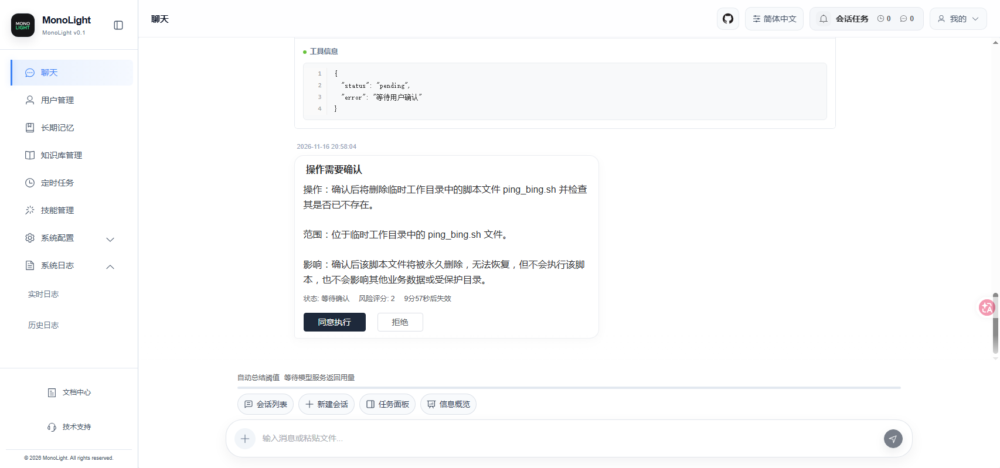
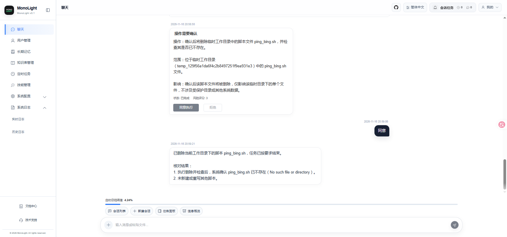

# MonoLight Safety Mechanisms / 安全机制说明

[English](#english) | [中文](#中文)

## English

### Threat model and safety boundary

MonoLight is a self-hosted assistant for running commands, editing files, and automating tasks. Its tool review addresses mistakes and misleading instructions that could cause unintended changes: deleting or overwriting files, modifying system settings, or accessing and sending sensitive data without authorization.

The review covers designated calls, including shell commands, file operations, and writes to interactive terminals. Other operations, such as fetching a web page or reading terminal output, use their own tool rules. The deployment assumes control of the host, database, and authorized accounts, and trust in the configured model providers. Account takeover, a compromised host, database, or model provider, and undoing side effects are outside this review's scope.

### Lightweight execution without a sandbox

MonoLight has run tools without a built-in sandbox from the start to keep deployment lightweight. The file tool checks allowed directories before writing. For shell commands and terminal input, the audit model applies the write rules to the changes it can identify. Shell commands and terminal programs run with the service account's operating-system permissions. File, network, and process isolation comes from the deployment environment.

Run MonoLight under a dedicated, low-privilege account. Choose a trusted audit provider: command arguments and file excerpts gathered as evidence can be sent to it.

### How the audit handles prompt injection

1. The audit model receives its rules in a separate system message. Proposed calls, directory rules, and any relevant task instructions or terminal history arrive as structured data. The audit request leaves out the main chat history and its summary. The audit prompt treats file contents and terminal output as evidence, not as instructions.
2. The server offers text-file reads and non-interactive shell commands for evidence gathering. Evidence calls must refer to a tool call under review and share a fixed budget. The audit prompt directs evidence commands to inspect only; they still run through a general-purpose shell.
3. The server checks that the model returns a structured result for each original call, with a matching call ID, risk score, denial flag, and reason. The server applies its own checks and the configured threshold. Format checks verify that a decision belongs to the right call; the model can still be misled into giving a valid-looking but incorrect risk assessment. Model output carries no user approval.

### Confirmation, duplicates, and rejection

1. **When approval applies.** A call flagged for confirmation waits for the user. For calls eligible for confirmation, scores of 8–10 require an explicit override (the dashboard's **Ignore and allow** button or `ignore` in WeChat). A directory-policy denial cannot be overridden by approval. A scheduled run blocks operations that would require approval.
2. **Where approval comes from.** The web card displays a pending record created by the server. The server takes web decisions from an authenticated account with write access to the conversation, and WeChat decisions from the sender bound to that conversation. The web buttons submit the same standalone decision words used in chat. Card text and assistant messages do not grant approval; a WeChat reply with a quote or attachment is not a decision.
3. **What happens on repeat submission.** Only one approval can claim the same pending, unexpired record, even if decisions arrive together. An HTTP retry with the same request ID and content reuses the original submission. The web and WeChat decisions target the conversation's current pending record, not a signed token for a particular card. Submitting the same approval word as a new message can approve a later pending operation.
4. **What can run.** Before executing an approved round, the server checks the execution token and verifies the original tool calls, arguments, and working directory against the stored fingerprint. A change to a file covered by the integrity check triggers another review while auditing is configured. Once the server records a rejection, that pending round will not run. If decisions arrive together, the first one to update the pending record wins. Rejection does not undo earlier actions or apply to a later proposal.

### Audit unavailable or timed out

- **Audit configured:** If risk scoring times out, the model or its channel is unavailable, or its results cannot be validated, the affected tool round does not run. If only the card summary fails after scoring, the server shows a standard summary and still waits for the user's decision.
- **Audit not configured:** A profile without an audit channel or model skips model review. Enabled tools still apply their own rules.

### What is recorded today

MonoLight stores review details, confirmation decisions, and execution status for audited tool calls. Existing records follow the server's retention settings. End-to-end audit trails and automated audit reports are planned.

### Verification

For a simple demo, configure the audit model and create a disposable file in an allowed directory. Ask MonoLight to delete that file. If the audit requests confirmation, choose **Reject**: the file stays in place and the card shows the rejection.

The integration tests simulate model responses and check the server's behavior:

- [Directory-policy denials and invalid audit responses](/tests/integration/test_audit_directory_policy.py)
- [Scoring failure stops execution; summary failure still waits for approval](/tests/integration/test_audit_llm_request_rejection.py)
- [Web and WeChat decision handling, including rejection and repeat approval](/tests/integration/test_confirmation_entry_flows.py)
- [Approval expiry and checks on the original call arguments](/tests/integration/test_audit_records.py)
- [HTTP retries, authenticated decision identity, and re-audit after a file changes](/tests/integration/test_confirmation_audit_reply_workflow.py)

#### Web approval screenshots

**Waiting for confirmation.** The card shows the proposed file deletion, its scope and impact, and the options to approve or reject it.

**Completed after approval.** The card shows the action as completed, and the chat reply reports the deletion result.

## 中文

### 威胁模型与安全边界

MonoLight 是一个自托管助手，可以执行命令、编辑文件和自动运行任务。工具审计针对模型误判或被外部内容误导后提出的操作，例如误删或覆盖文件、修改系统设置，以及未经授权读取或外传敏感数据。

审计覆盖指定工具调用，包括 Shell 命令、文件操作和向交互终端写入内容。网页抓取、读取终端输出等操作走各自的工具规则。部署以宿主机、数据库和有权操作的账号处于可信控制下为前提，也需要信任所配置的模型渠道。账号被接管、主机、数据库或模型渠道被控制，以及撤回已发生的操作，都超出这层审计的范围。

### 轻量部署，不使用沙箱

MonoLight 从项目初期就选择不使用内置沙箱，以保持部署轻量。文件工具在写入前检查目标是否位于允许的目录内。对于 Shell 命令和终端输入，审计模型按它能识别的修改目标检查写入规则。Shell 命令和终端程序按服务进程的系统账号权限运行，文件、网络和进程隔离由部署环境提供。

部署时使用专用低权限账号，并选用可信的审计模型渠道：命令参数和取证读到的文件片段可能随请求发给该渠道。

### 审计如何处理提示词注入

1. 审计规则作为独立的系统消息发送。待审调用、目录规则及相关任务指令或终端历史放在结构化字段中；审计请求不包含主对话历史和摘要。审计提示要求模型把文件内容和终端输出当作证据，而不是审计指令。
2. 服务端只提供文本读取和非交互式 Shell 两类取证工具，取证必须关联本轮调用，并共用调用次数上限。审计提示要求取证命令只做检查，实际使用的仍是通用 Shell。
3. 服务端核对每个审计结果是否包含匹配的工具调用编号、风险评分、拒绝标记和理由，再结合本地检查及配置阈值处理。格式校验核对的是结果与调用的对应关系；模型仍可能被构造的内容误导，给出格式正确但判断有误的结果。模型输出本身不是用户授权。

### 确认、防重复执行与拒绝

1. **何时确认。** 审计判定需要确认时，先等待用户决定。对可确认的调用，风险评分为 8–10 分时，须明确选择网页上的「忽略并放行」或在微信回复「忽略」。目录写入规则判定为违规的调用直接拦截，确认也不会放行。定时任务遇到需要确认的操作时直接拦截。
2. **谁能确认。** 网页卡片展示服务端生成的待确认记录。网页只接受对该会话有写权限的登录账号提交决定；微信按发送者与会话的绑定关系识别决定。网页按钮发送的也是单独一条确认关键词。卡片文案和模型回复本身不会变成授权；带引用或附件的微信回复不会被当成确认决定。
3. **重复提交。** 同一条尚未过期的待确认记录只能放行一次，由数据库处理同时到达的决定。网页 HTTP 请求使用同一请求编号和内容重试时，复用原提交结果。网页和微信处理的都是当前会话正在等待确认的操作，消息没有绑定到某张卡片。把同样的「同意」作为新消息再发一次，可能确认之后出现的另一项操作。
4. **执行与拒绝。** 执行前，服务端核对执行凭证，以及原工具调用、参数和工作目录的校验值。配置了审计时，纳入校验的文件发生变化会重新审计。服务端记为「已拒绝」后，这批待确认调用不会执行。批准和拒绝同时到达时，以先更新待确认记录的决定为准。拒绝只针对这一批调用，不撤回已发生的操作，也不替以后提出的操作作决定。

### 审计模型不可用或超时

- **已配置审计：** 风险评分请求超时、模型或渠道不可用，或评分结果无法通过校验时，这批工具不执行。若评分已完成，仅卡片摘要生成失败，则用默认摘要展示卡片，仍等待用户决定。
- **未配置审计：** 配置文件缺少审计渠道或模型时，跳过模型审计，已启用的工具仍按各自规则运行。

### 已有记录与规划

当前会保存已审计工具调用的判定明细、确认决定和执行状态，记录按服务端保留策略清理。「全程留痕」和自动生成审计报告仍在规划中。

### 如何验证

先配置审计模型，再在允许操作的目录里创建一个临时文件，请 MonoLight 删除该文件。若审计要求确认，选择「拒绝」：文件会保留，卡片显示「已拒绝」。

以下集成测试通过模拟模型响应来验证服务端行为：

- [违规写入拦截与审计输出校验](/tests/integration/test_audit_directory_policy.py)
- [评分失败停止执行，摘要失败仍等待确认](/tests/integration/test_audit_llm_request_rejection.py)
- [网页和微信的拒绝与重复确认](/tests/integration/test_confirmation_entry_flows.py)
- [确认过期和原调用参数校验](/tests/integration/test_audit_records.py)
- [网页请求重试、确认人身份和文件变化后的复查](/tests/integration/test_confirmation_audit_reply_workflow.py)

#### 网页确认截图

**等待确认。** 卡片列出拟删除的文件、操作范围和影响，可选择同意或拒绝。

**同意后完成。** 卡片显示「已完成」，对话中列出删除结果。

